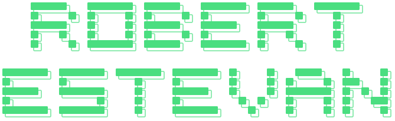

**Desenvolvimento · Automação · Infraestrutura**

Gosto de pegar um problema real, entender o processo e entregar uma ferramenta que as pessoas usam de verdade, do backend ao app Android.

---

### ⚙️ Backend & Automação

    

### 🎨 Frontend & Mobile

       

### 🗄️ Dados & Infra

      

### 🔌 Integração com hardware

  

---

### 🔧 Projetos

| Projeto | O que é | Stack |
|---|---|---|
| [**Kolô**](https://github.com/caioalves19/tcc-2) | TCC em equipe: site de um estúdio de tatuagem com catálogo, carrinho, checkout, agendamento e painel administrativo | Next.js · Prisma · PostgreSQL |
| [**Gerador de etiquetas**](https://github.com/restevan3/Gerador-de-etiquetas) | Etiquetas com QR Code para identificar e inventariar balanças, impressas direto na Zebra | Python · Streamlit · PostgreSQL · Docker |
| [**Teste de impressora e gaveta**](https://github.com/restevan3/Teste-em-impressora-e-gaveta-PDV) | Testa a impressora ESC/POS e a gaveta do PDV por serial, USB ou rede | Python · Tkinter |
| [**Tower Defense**](https://github.com/restevan3/Tower-Defense) | Caminho de menor dano num tabuleiro, com DFS e backtracking | Python |

Também desenvolvo ferramentas internas, que não estão aqui por serem da empresa: um app Android de modo quiosque para tablets, uma plataforma de controle de acessos e desligamentos de colaboradores e um painel de vagas para o RH.
